# C1 bass model: before and after

> Historical rework evidence: the measurements and six-view gallery below describe an earlier unaccepted checkpoint. The targeted jaw reconstruction is now in progress; see [PROJECT_STATE](../PROJECT_STATE.md), [jaw references](C1_JAW_REFERENCES.md) and [independent jaw review](C1_JAW_REVIEW.md). Do not attribute these earlier metrics or reproduction commands to the current candidate. Current handoff and commands are in [jaw modeling](C1_JAW_MODELING.md) and [jaw validation](C1_JAW_VALIDATION.md).

The **before** column rerenders the earlier C1 mesh with the rework's studio lighting. The **after** column shows the photo-referenced rework with the same named cameras and lights, so the geometry and material changes can be compared under equivalent conditions. The originally rejected gallery, along with [its review](evidence/c1/before/C1_REVIEW.md) and original manifest, remains unchanged under `evidence/c1/before/`. Technical validation and an independent review remain separate from the user's visual approval.

| View | Before | After |
| --- | --- | --- |
| Left profile | [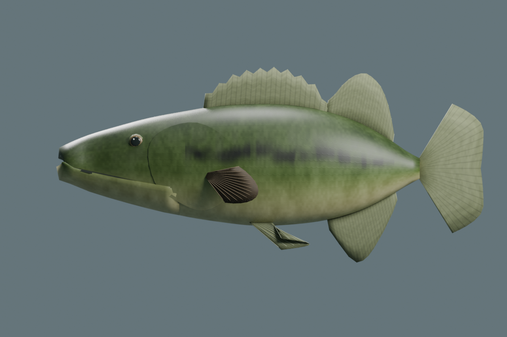](evidence/c1/before-matched-lighting/left.png) | [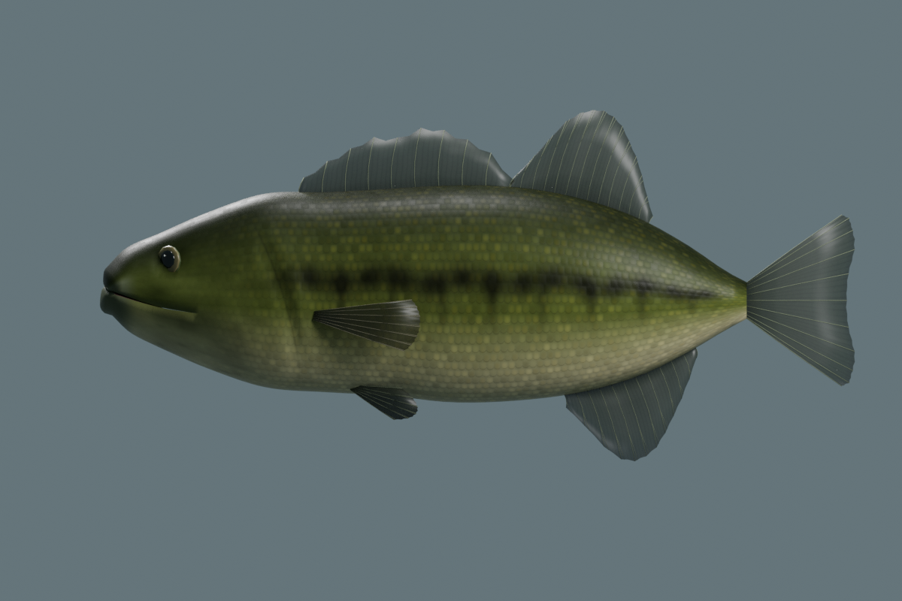](evidence/c1/rework-1/left.png) |
| Right profile | [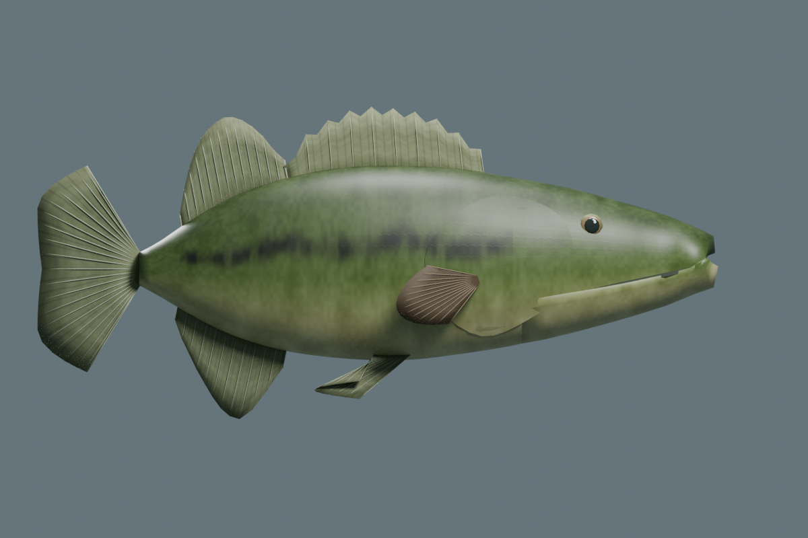](evidence/c1/before-matched-lighting/right.png) | [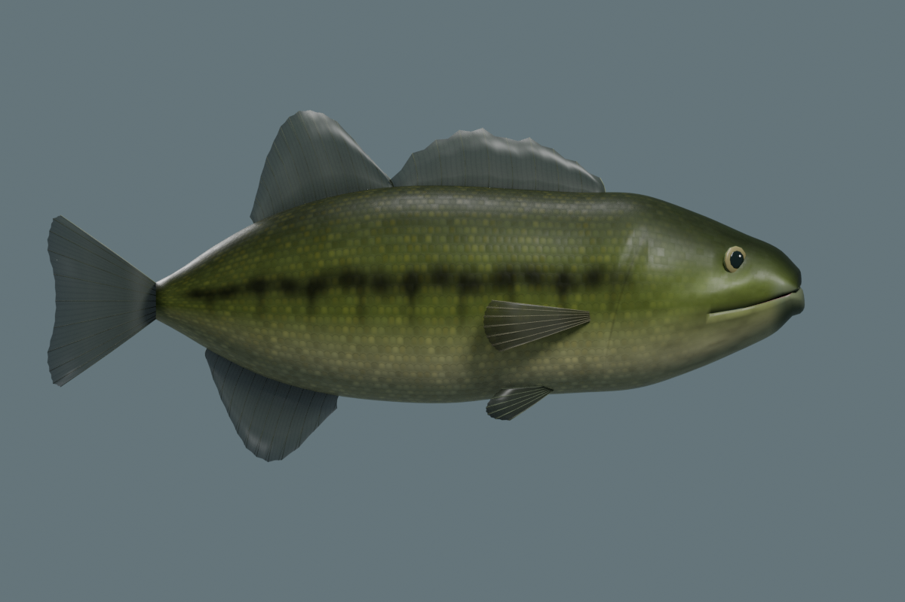](evidence/c1/rework-1/right.png) |
| Front | [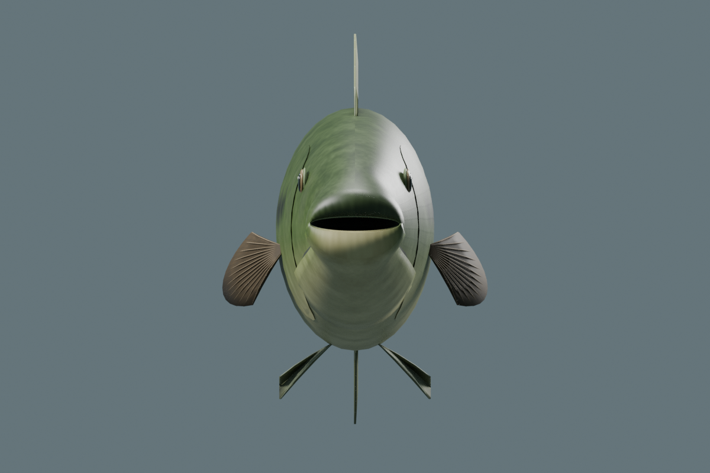](evidence/c1/before-matched-lighting/front.png) | [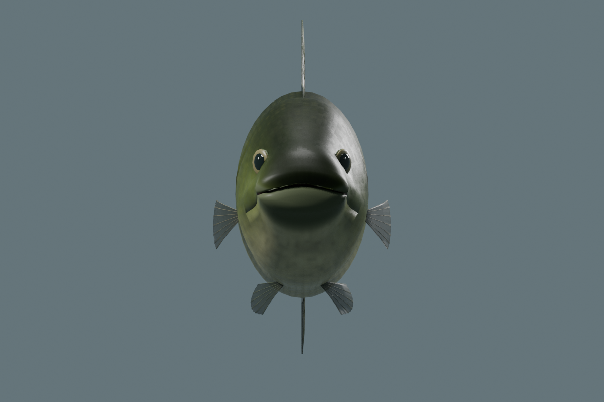](evidence/c1/rework-1/front.png) |
| Rear | [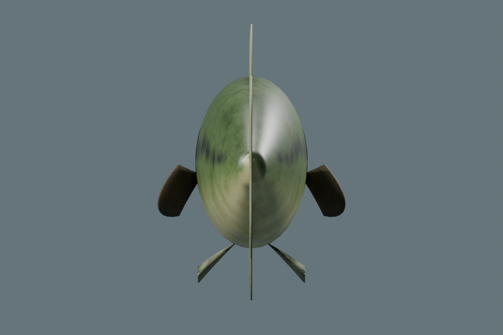](evidence/c1/before-matched-lighting/rear.png) | [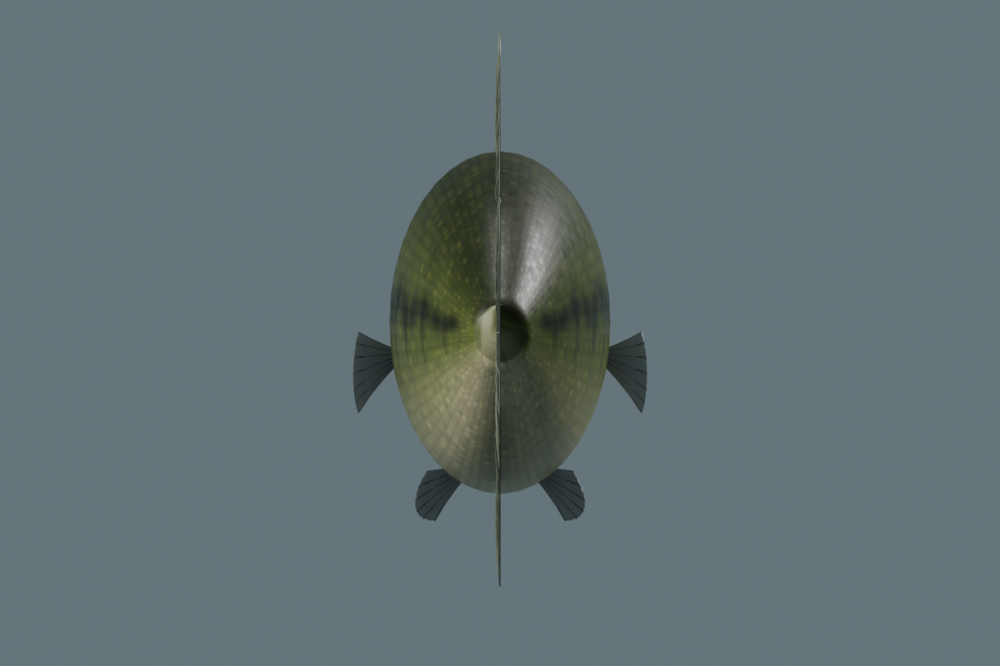](evidence/c1/rework-1/rear.png) |
| Top | [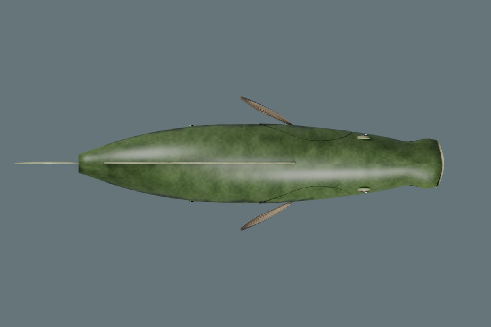](evidence/c1/before-matched-lighting/top.png) | [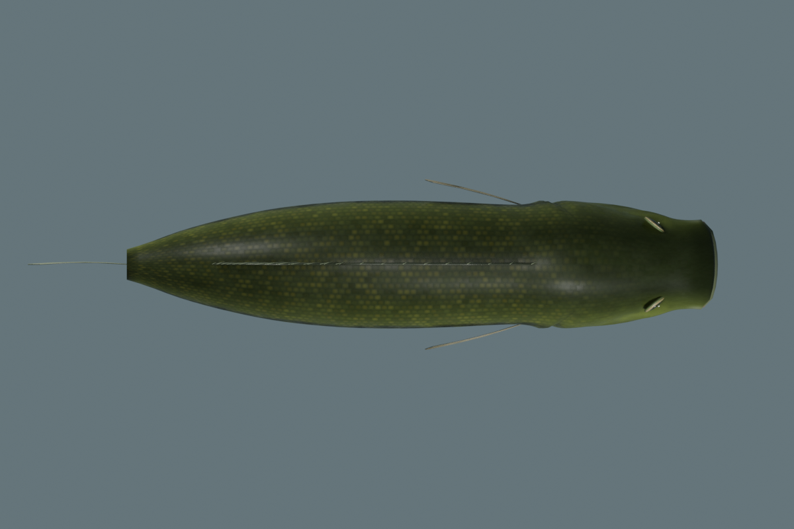](evidence/c1/rework-1/top.png) |
| Front three-quarter | [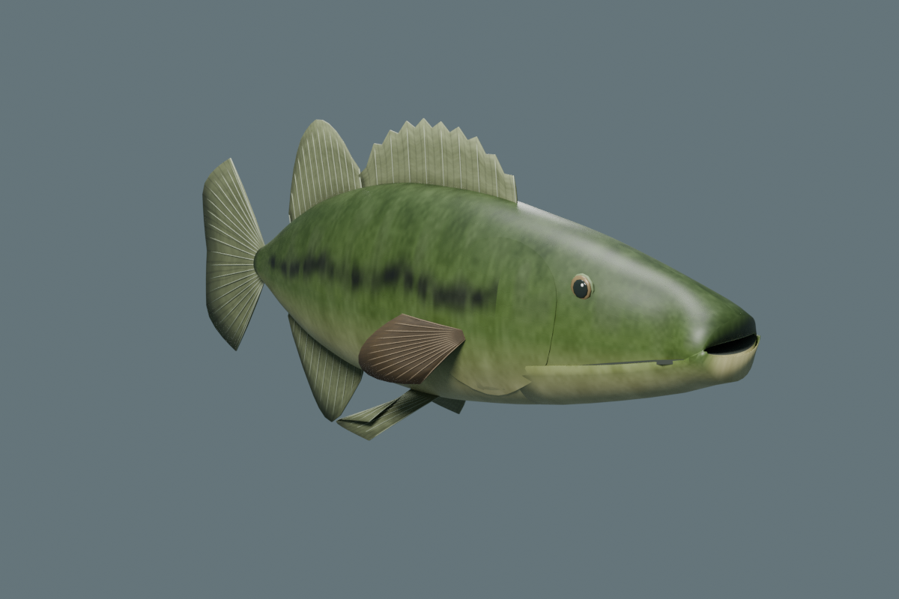](evidence/c1/before-matched-lighting/front_three_quarter.png) | [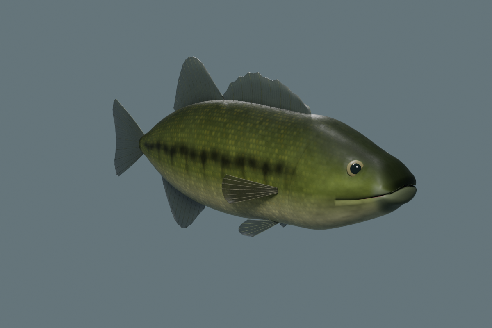](evidence/c1/rework-1/front_three_quarter.png) |

[Original rejected gallery manifest](evidence/c1/before/manifest.json) · [Matched-lighting baseline manifest](evidence/c1/before-matched-lighting/manifest.json) · [Current evidence manifest](evidence/c1/rework-1/manifest.json) · [Photographs used for anatomical reference](C1_PHOTO_REFERENCES.md)
