# C1 jaw reconstruction — matched comparison gallery

**C1 NOT ACCEPTED. Astra recommends HOLD.** The mesh repairs detected folds and contains genuine lip/jaw volume and a recessed cavity, but the upper rim, maxillary terminal and lower oral tip remain anatomically unresolved. See [independent review](C1_JAW_REVIEW.md) and [validation/budget report](C1_JAW_VALIDATION.md).

Each before/after pair uses the same fixed orthographic camera, neutral white lighting, 1600 × 1000 resolution and 128 Cycles samples without denoising. **Before** is the saved pre-jaw model (21,762 triangles), not the original 10,976-triangle performance reference. After is the frozen 22,254-triangle proposal. All image and asset hashes are in [the manifest](evidence/c1/jaw/manifest.json).

The private portable gallery is `artifacts/c1/anatomical-revision-v2/jaw-qa/jaw-comparison.html`. It embeds the unaltered renders and the three licensed real photographs beside relevant comparisons. It remains ignored and must not be publicly published with the photos. Public source records below link to the photographs; their perspectives and rights are documented in [jaw references](C1_JAW_REFERENCES.md).

## Full-body lateral

| Saved checkpoint | Revised proposal |
| --- | --- |
|  | [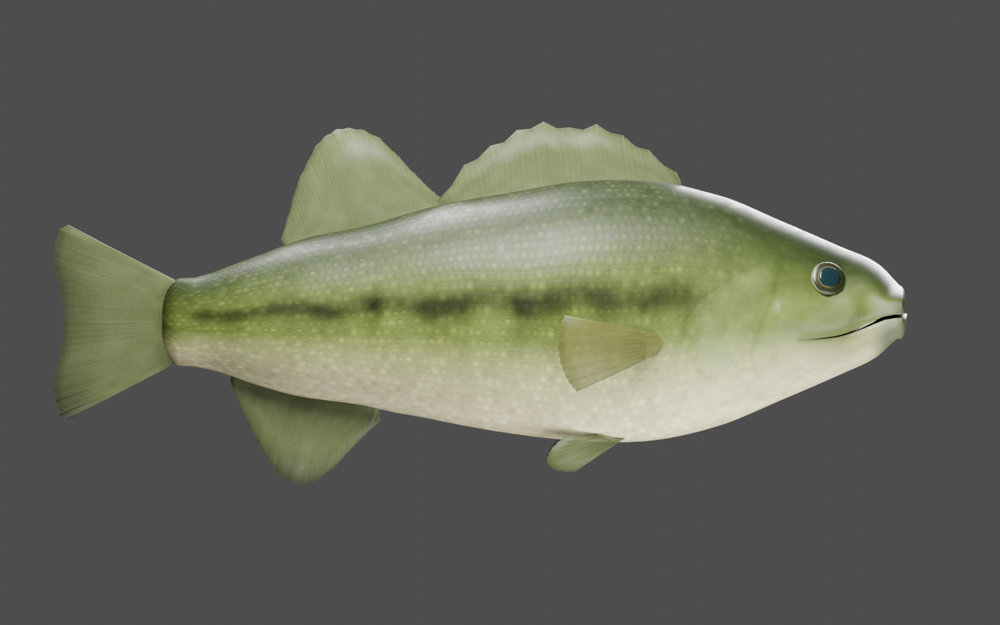](evidence/c1/jaw/after/full_body_lateral.png) |

Photographic guide: [actual bass source 306335267](https://stock.adobe.com/images/id/306335267).

## Left mouth profile

| Saved checkpoint | Revised proposal |
| --- | --- |
| [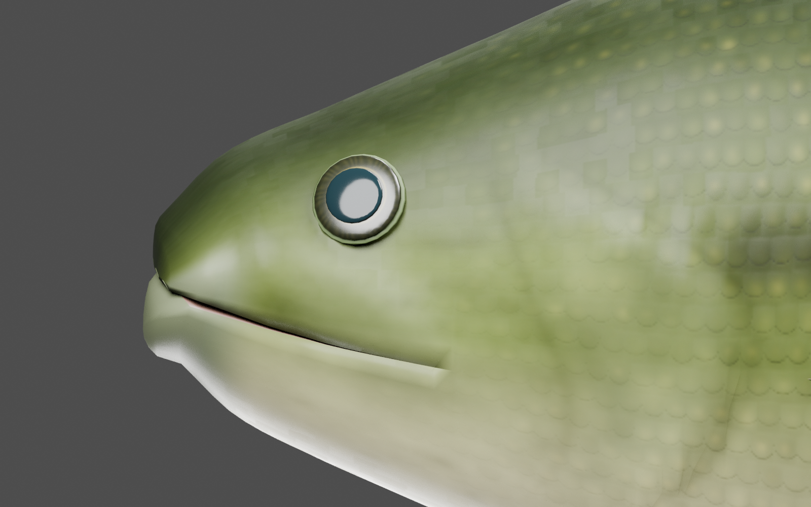](evidence/c1/jaw/before/close_left_mouth.png) | [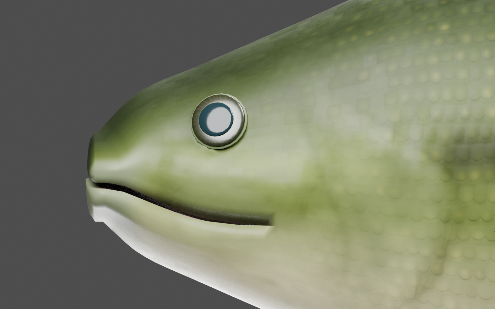](evidence/c1/jaw/after/close_left_mouth.png) |

Photographic guide: [actual bass source 306335267](https://stock.adobe.com/images/id/306335267).

## Right mouth profile

| Saved checkpoint | Revised proposal |
| --- | --- |
| [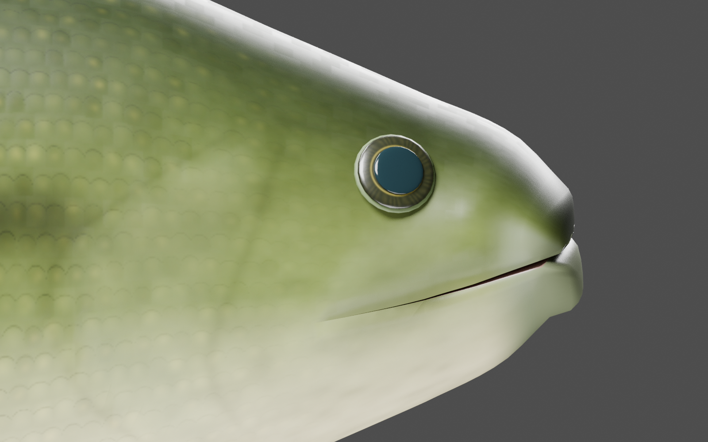](evidence/c1/jaw/before/close_right_mouth.png) | [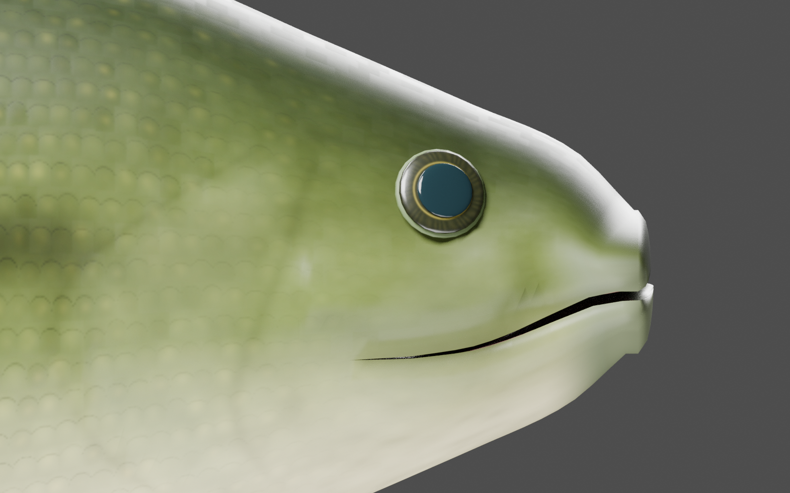](evidence/c1/jaw/after/close_right_mouth.png) |

Photographic guide: [actual bass source 306335267](https://stock.adobe.com/images/id/306335267).

## Front mouth

| Saved checkpoint | Revised proposal |
| --- | --- |
| [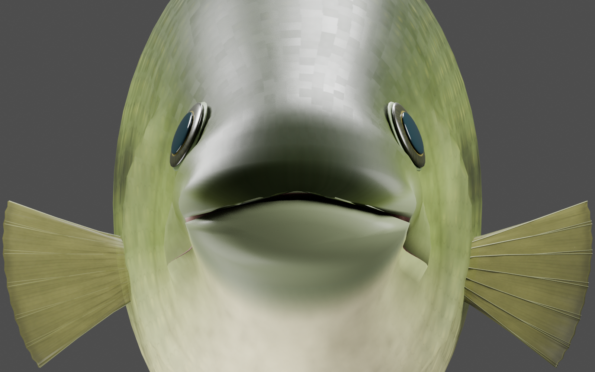](evidence/c1/jaw/before/front_mouth.png) | [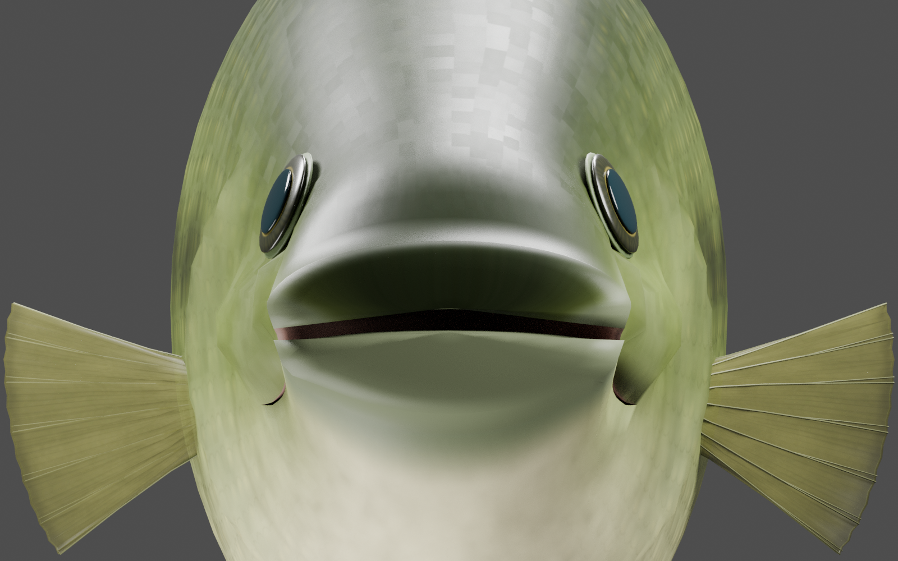](evidence/c1/jaw/after/front_mouth.png) |

Photographic guide: [actual bass source 512226129](https://stock.adobe.com/images/id/512226129).

## Top snout and jaw

| Saved checkpoint | Revised proposal |
| --- | --- |
| [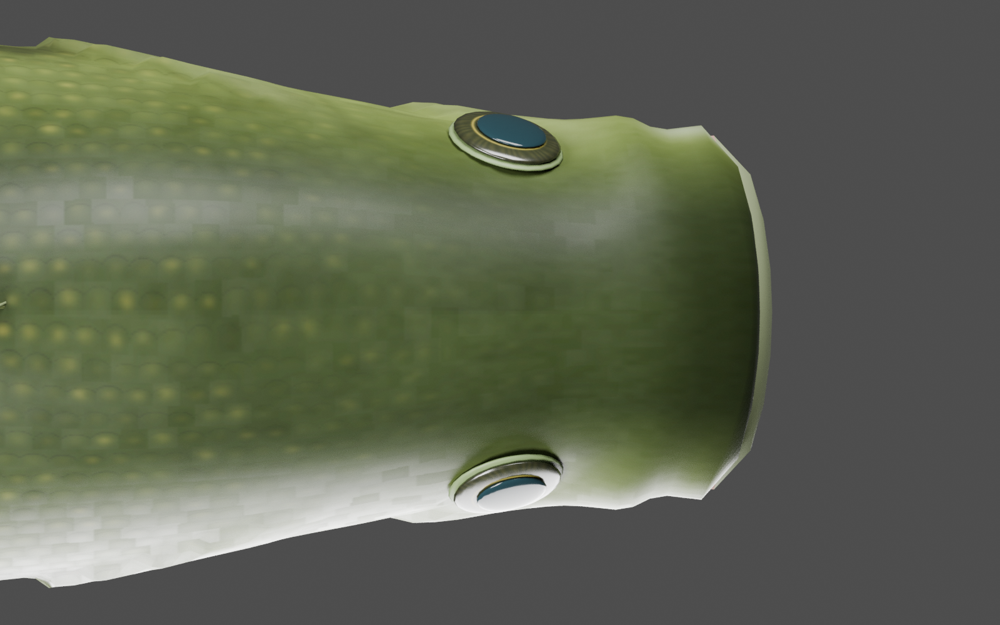](evidence/c1/jaw/before/top_snout_jaw.png) | [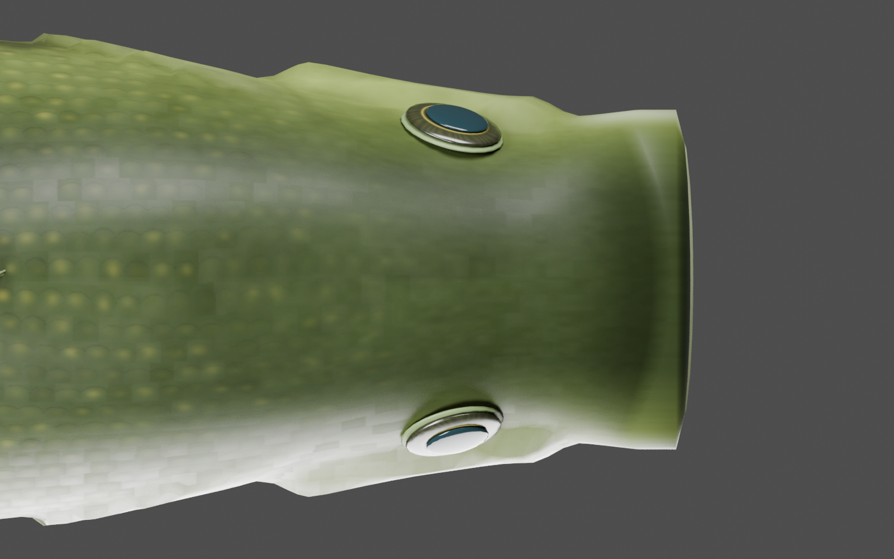](evidence/c1/jaw/after/top_snout_jaw.png) |

Photographic guide: [actual bass source 306335267](https://stock.adobe.com/images/id/306335267).

## Front three-quarter head

| Saved checkpoint | Revised proposal |
| --- | --- |
| [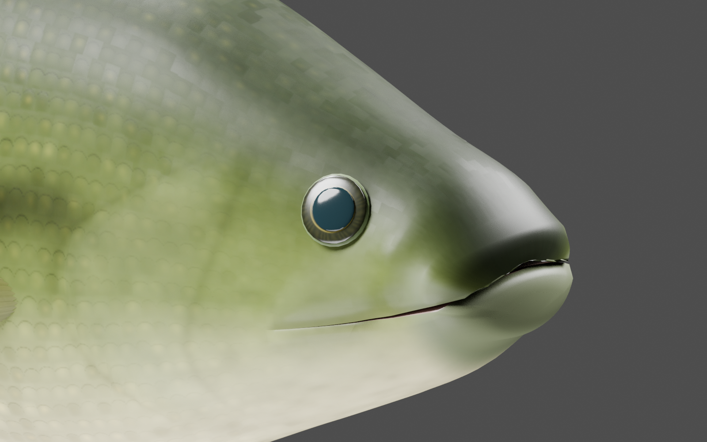](evidence/c1/jaw/before/front_three_quarter_head.png) | [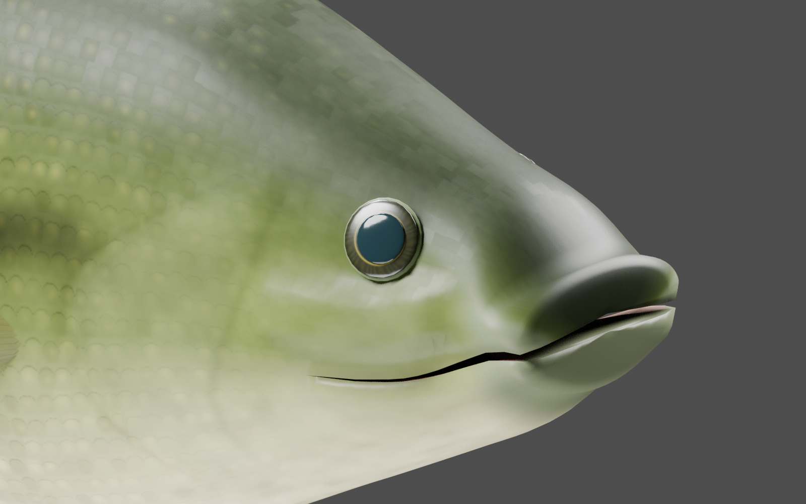](evidence/c1/jaw/after/front_three_quarter_head.png) |

Photographic guide: [actual bass source 306335267](https://stock.adobe.com/images/id/306335267).

## Temporary 25° opening

| Saved checkpoint | Revised proposal |
| --- | --- |
| [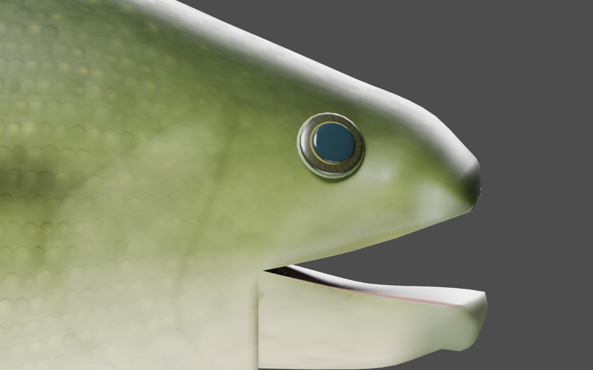](evidence/c1/jaw/before/jaw_open_25deg.png) | [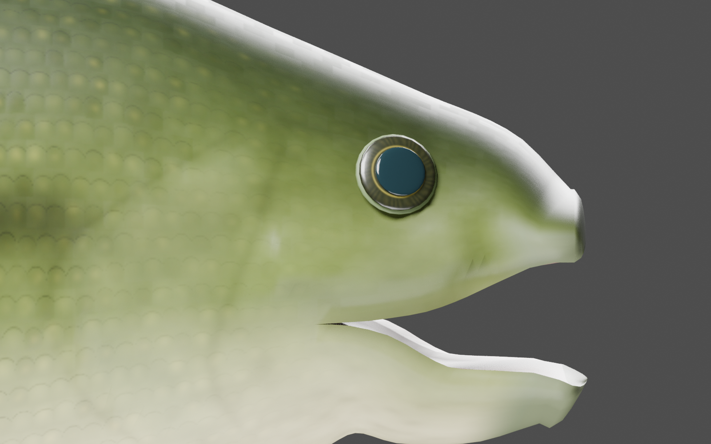](evidence/c1/jaw/after/jaw_open_25deg.png) |

Photographic guide: [actual bass source 482505893](https://stock.adobe.com/images/id/482505893).

## Supplemental opening depth comparison

| Saved checkpoint | Revised proposal |
| --- | --- |
| [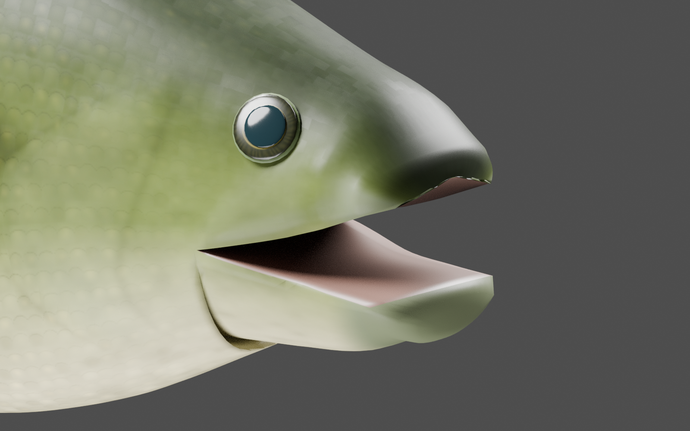](evidence/c1/jaw/supplemental-open/before/jaw_open_25deg.png) | [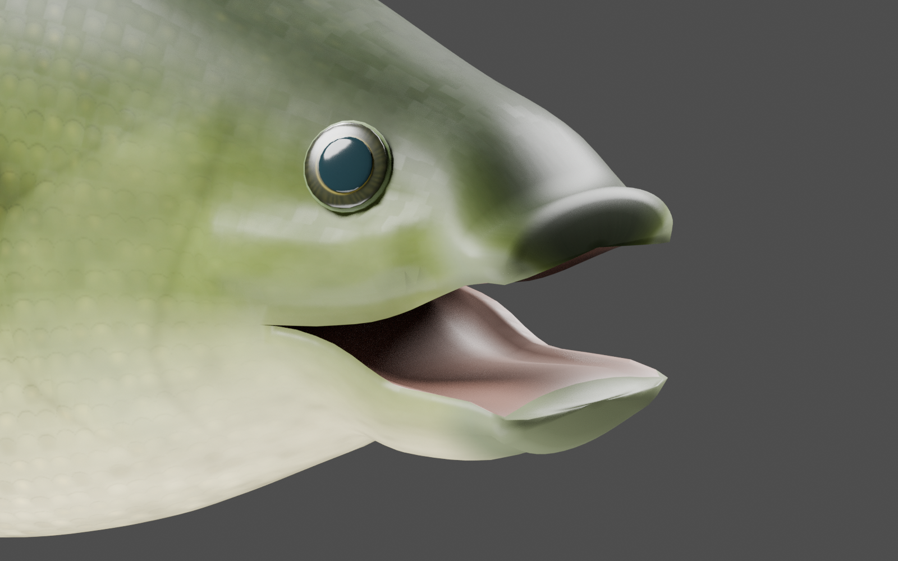](evidence/c1/jaw/supplemental-open/after/jaw_open_25deg.png) |

The 25° pose is a temporary weighted lower-jaw deformation, not an animation or feeding biomechanics claim. [Stock 482505893](https://stock.adobe.com/images/id/482505893) demonstrates oral walls and lip thickness; a hand forces its extreme gape, so its angle is not the target pose.

[Three.js exported-model screenshot](evidence/c1/jaw/largemouth-bass-browser.png) · [Primary jaw report](evidence/c1/jaw/jaw-qa-report.json) · [Supplemental report](evidence/c1/jaw/supplemental-open/jaw-qa-report.json) · [Expanded head self-crossing regression](evidence/c1/jaw/head-self-regression.json)

Blender asset: `artifacts/c1/anatomical-revision-v2/largemouth-bass.blend`. Export: sibling `largemouth-bass.glb`. The articulated QA fixture is `jaw-qa/after/articulated.blend`; production asset and GLB contain no rig or clips. [Reproduction commands](C1_JAW_MODELING.md).

The 22,254-triangle budget is an unapproved proposal (+11,278 over the original reference); nine draw calls and five embedded maps do not approve that increase or establish iPhone performance. No merge, C2 or Fish Factory work is authorized.
