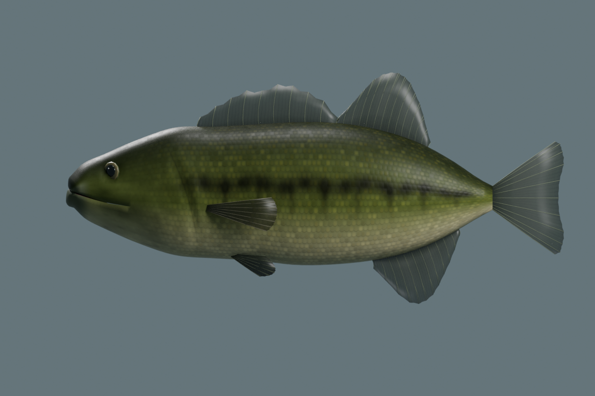
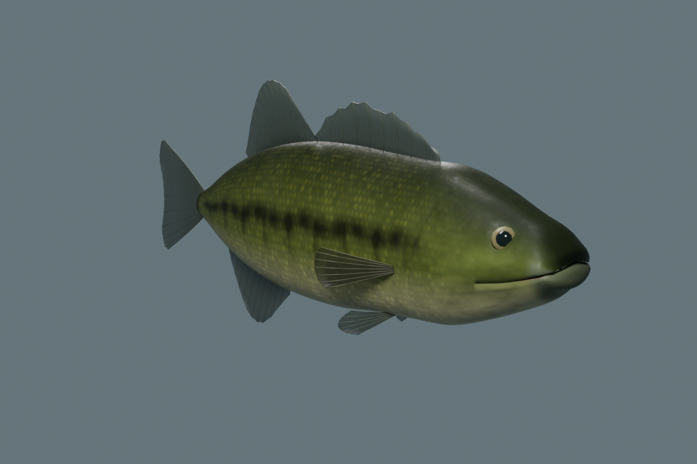

# C1 — largemouth bass modeling rework

> Historical rework evidence: the measurements and six-view gallery below describe an earlier unaccepted checkpoint. The targeted jaw reconstruction is now in progress; see [PROJECT_STATE](../PROJECT_STATE.md), [jaw references](C1_JAW_REFERENCES.md) and [independent jaw review](C1_JAW_REVIEW.md). Do not attribute these earlier metrics to the current candidate.


Status: revised C1 candidate delivered for inspection. The owner's earlier C1 candidate was rejected against the requested production realism standard. The independent reviewer recommends **HOLD for further visual refinement**, and user visual approval is pending. C1 is open; C2 rigging, weights, swim clips and gameplay integration have not started.

## Scope and source of truth

The work began from `main` at `0ce0fc6143ea0b4827acd3d341f862a4c2e5090b` on `dev/c1-largemouth-bass`; the concurrent game-design change at `95f63b0` is incorporated. C0 application and simulation are preserved. The user's C1 modeling request moves animation development to C2, superseding the older roadmap sequence.

The deterministic Blender 4.3.2 Python authoring source is `tools/blender/generate_bass.py`, with original procedural material construction in `tools/blender/bass_materials.py`. The latter is code for PBR maps, not a downloaded or AI-generated texture. Generated `.blend`, GLB, textures and working reports live under ignored `artifacts/c1/`. The final six Blender renders, evidence reports and manifests live under `docs/evidence/c1/`; the earlier C1 candidate is retained under `docs/evidence/c1/before/` for direct comparison.

## What changed in the rework

The body mesh now branches continuously behind the eye into the upper skull and a substantial lower mandible. The branches share a rear hinge and form a recessed palate/tongue opening. This replaces the prior jaw assembled from visibly overlapping strips. The cheek and opercular curve are sculpted into the continuous skin surface. The nose is shorter and blunter, the eye moves forward, and the mouth seam bows across the muzzle. Body depth and caudal-peduncle taper were revised against a complete side photograph. A head-on photo guided the broad forehead, jaw volume and lateral pectoral placement.

The spiny and soft dorsal parts retain their distinct notch; the posterior dorsal, pectoral, pelvic, anal and shallowly emarginate caudal outlines were revised as thin, curved membranes with radial rays. The procedural body maps now resolve overlapping scale cells, pigment differences, irregular connected lateral blotches and regional roughness. Normal relief is derived from small physical scale height. Fin maps include radial striation, edge variation and controlled alpha. [Photographic reference observations](C1_PHOTO_REFERENCES.md) record actual inspected image pixels and the limits of each view; [species sources](C1_REFERENCES.md) provide separate written anatomy evidence. The photos remain local review material and are not application assets.

The photographs do not alone determine exact spine or ray counts. In the full-profile photo, the anterior dorsal is folded down and the far tail edge meets the frame. The generator's ray layout therefore remains an artistic anatomical interpretation to judge in the six renders.

## Reproduce and inspect

```sh
npm ci
npm ci --prefix tools/blender
npm run generate:bass --prefix tools/blender -- --render-samples 128
npm run test:bass --prefix tools/blender
```

Run from the repository root. The generator uses seed `1947` by default. Parameters and procedural geometry/maps are reproducible; Blender file metadata is not promised byte-for-byte identical across reruns. Use the final manifest hashes to identify a specific reviewed `.blend`/GLB pair.

To reproduce the matched-light **before** gallery from the preserved rejected Blender file, run:

```sh
blender --background --python-exit-code 1 --python tools/blender/render_bass_baseline.py -- --baseline artifacts/c1/before/largemouth-bass.blend --output docs/evidence/c1/before-matched-lighting
```

If that ignored `.blend` is absent, regenerate it from the exact rejected generator committed at `035700d`. Its SHA-256 is `8a327c4af4f1945d2dc491f61c684a984b42a245db4d1ab01974591c8b7d3bf1`, matching the archived manifest:

```sh
git show 035700d:tools/blender/generate_bass.py > /tmp/fish-io-c1-baseline-generator.py
blender --background --python-exit-code 1 --python /tmp/fish-io-c1-baseline-generator.py -- --output artifacts/c1/before --skip-renders
blender --background --python-exit-code 1 --python tools/blender/render_bass_baseline.py -- --baseline artifacts/c1/before/largemouth-bass.blend --output docs/evidence/c1/before-matched-lighting
```

The replay script changes studio-light power and size, camera framing and Cycles sampling. It does not edit the rejected fish mesh or its materials. The original rejected images and reports under `docs/evidence/c1/before/` remain intact.

The final gallery is rendered at 1200 × 800 with 128 Cycles samples per view. Five principal views use orthographic cameras aligned to the authoring axes; the front three-quarter view uses a 60 mm perspective camera. The studio lighting was revised to reveal surface and head form more evenly. A separate `before-matched-lighting/` set rerenders the earlier mesh with the new lights and the same cameras for fair comparison; the original rejected render set under `before/` stays unchanged. The GLB exports the fish asset, not the studio rig. The isolated Three.js viewer verifies the actual exported material and texture decoding in cloud Chromium; Blender renders alone cannot establish exported appearance.

The independent geometry checker tests explicit anatomical parts, finite geometry and UVs, shared-edge winding and closed outward-facing required volumes. Declared thin membranes can have allowed boundaries. These checks cannot prove anatomical accuracy or exclude every self-intersection. A rig-friendly authoring layout is a starting point for C2, not demonstrated skin deformation.

## Measured cost and limits

These are the frozen post-rework measurements from the Blender stats, GLB validator and actual Three.js render. The earlier candidate's costs remain in the archived evidence.

| Measurement | Reworked candidate |
| --- | --- |
| Authoring geometry | 18 anatomical objects; 7,435 vertices; 14,326 triangles |
| GLB geometry | 1 glTF mesh / 10 material primitives; 11,028 exported vertices; 14,326 triangles |
| Actual Three.js render | 10 draw calls / 14,326 triangles for one fish |
| Asset length | 0.45202 m |
| GLB size and identity | 3,513,480 bytes; SHA-256 `ed28f05b0114ebcb7f92079d698f4edcdee7cd47f3e656158ac88d9d19cc9371` |
| Blender source identity | 4,478,332 bytes; SHA-256 `54f7f280127d3571509a624c02d364d92e1e7772c173945be998f39b9a1c942c` |
| Textures | Body color, normal and roughness/metalness export at 1024²; olive fin and amber pectoral color/alpha at 512² |
| Estimated texture residency | 18.67 MiB for five unique RGBA8 images with full mip chains; estimate, not GPU measurement |
| Rig / animation | No skin, deform bones or animation clips; C2 not started |

The Khronos GLB validator reports zero errors and zero warnings. Independent Blender geometry checks report no failures; all five embedded images decoded in the browser. A single connected closed body mesh contains distinct upper/lower jaw face regions; fin membranes are closed and outward-facing. Those passes establish technical validity, not photographic anatomy or realistic shading.

The provisional C0 budgets remain approximately 8k/3k/1k triangles for eventual LODs, at most 100 scene draw calls and 150k visible triangles, at most 128 MiB scene texture residency, at most 24 deform bones and initial 1k textures. The reworked fish exceeds the proposed 8k near-LOD target by 6,326 triangles. Eight fish would contribute 114,608 triangles and 80 draw calls before habitat rendering; that arithmetic is not a population benchmark. LODs, compression, population rendering, thermal behavior and physical Safari/iPhone profiling remain unqualified. C1 reports asset cost, not an achieved device frame rate.

## Visual gate and gallery

Technical validity and improvement over the rejected model do not grant visual acceptance. The [independent final review](C1_REVIEW.md) recommends further refinement of the cranial planes, repeated scalloped scale pattern and orderly fin sheets. The user should inspect all six views, the exported-model screenshot and the [six-view comparison](C1_COMPARISONS.md) before deciding whether the C1 fish meets the requested realism standard. C2 starts only after the user accepts this C1 asset and gives further instruction.

Anatomical left is +Y and right is −Y in authoring coordinates. The front three-quarter view looks from +X/−Y/+Z.

| Left profile | Right profile |
| --- | --- |
| [](evidence/c1/left.png) | [](evidence/c1/right.png) |

| Front | Rear |
| --- | --- |
| [](evidence/c1/front.png) | [](evidence/c1/rear.png) |

| Top | Front three-quarter |
| --- | --- |
| [](evidence/c1/top.png) | [](evidence/c1/front_three_quarter.png) |

[Three.js exported-model screenshot](evidence/c1/largemouth-bass-browser.png) · [Current manifest](evidence/c1/manifest.json) · [Browser validation](evidence/c1/browser-validation.json) · [Independent Blender geometry validation](evidence/c1/blender-geometry-validation.json)
