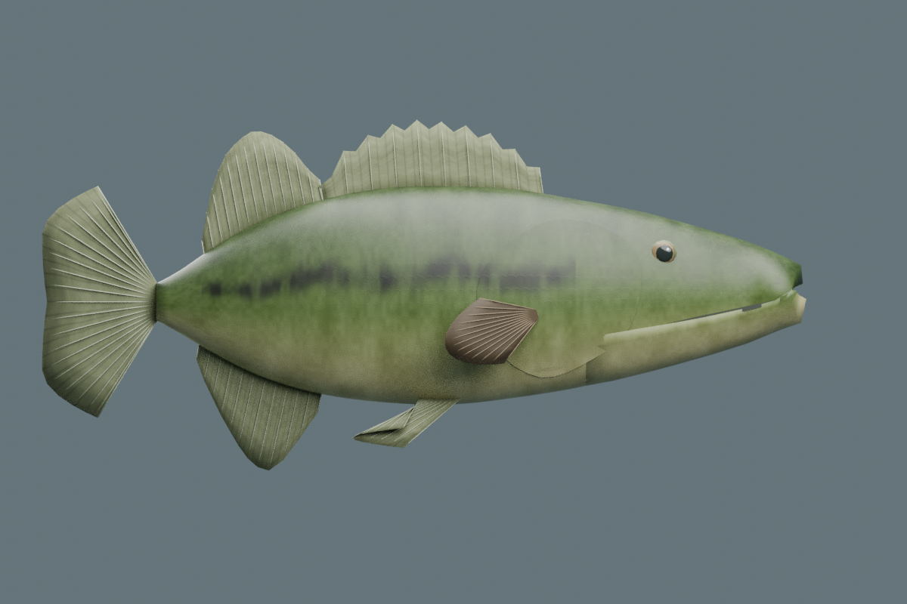
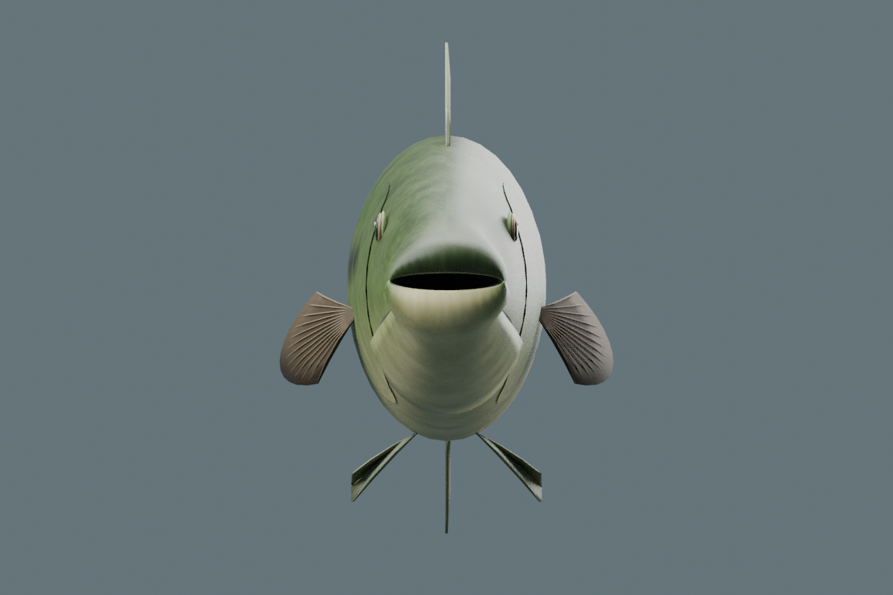
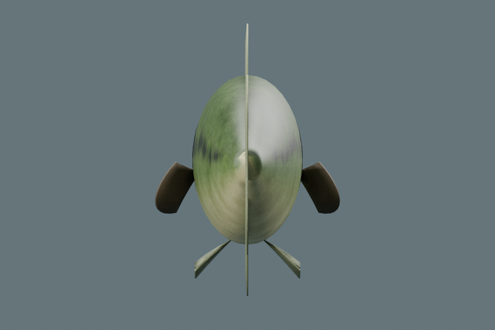
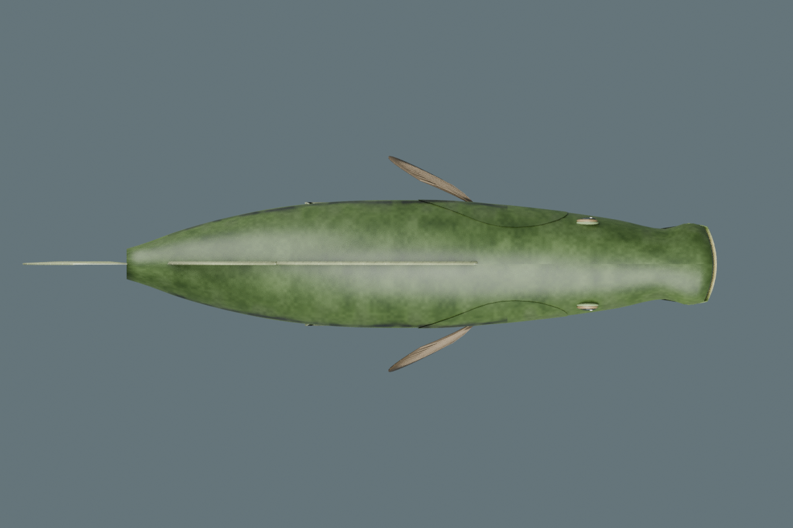

# C1 — largemouth bass modeling candidate

Status: modeling candidate awaiting user visual approval. No C2 rig, weights, swim clips, or gameplay integration are authorized by this delivery.

## Scope and source of truth

Base: `main` at `0ce0fc6143ea0b4827acd3d341f862a4c2e5090b`. Development branch: `dev/c1-largemouth-bass`. C0 application, simulation and smoke fixture are preserved. The user's C1 request explicitly moves animation development to C2; this supersedes the earlier roadmap wording.

The deterministic Blender 4.3.2 Python generator is the authoring source. Generated `.blend`, GLB, textures and machine reports live under ignored `artifacts/c1/`. The six PNG reference views under `docs/evidence/c1/` are review evidence, not a substitute for the actual model. Photographic/anatomical sources and their limitations are recorded in [C1 references](C1_REFERENCES.md).

## Approval boundary

Geometry, export and runtime tests establish technical properties only. Anatomical accuracy, silhouette, proportions, fin placement, shading and overall realism require human inspection of all six views. This asset is not visually accepted until the user approves it. C2 must not begin from an automated pass or an agent's recommendation.

“Animation-ready” in C1 means an intentional authoring topology and separate anatomical parts suitable for later rig development. It does not mean proven deformation: skinning, weight painting, extreme-pose testing and swimming loop review belong to C2.

## Mobile qualification

The C0 budgets remain provisional: around 8k/3k/1k triangles for eventual LODs, <=100 scene draw calls, <=150k visible triangles, <=128 MiB scene texture residency, <=24 deform bones, 1k textures initially. C1 reports the actual asset cost; it does not claim achieved iPhone frame rates. Cloud Chromium uses SwiftShader and cannot predict Safari GPU performance, thermal behavior or gameplay population limits. LODs, compression and physical-device profiling must be qualified before shipping.

## Reproduce and inspect

```sh
npm ci
npm ci --prefix tools/blender
npm run generate:bass --prefix tools/blender
npm run test:bass --prefix tools/blender
```

Run from the repository root. The generator checks Blender 4.3.2 and uses seed `1947` by default. Parameters and generated geometry/textures are reproducible; Blender file metadata is not promised byte-for-byte identical across reruns. Use the report's SHA-256 hashes to identify a specific reviewed `.blend`/GLB pair.

The six views use orthographic cameras, with left/right/front/rear/top aligned to the source axes and a front three-quarter view for volume. A studio light setup is for inspection, not baked gameplay lighting. The GLB must export selected asset meshes only, with no studio cameras or lights. Render and inspect all six after any geometry, material or export change; diagnostic single-view runs are not complete approval evidence.

The isolated viewer at `tools/blender/viewer.html` is test tooling. The automated runner starts its own localhost server, uses the pinned Three.js loader and cloud Chromium, records a screenshot and metrics, and closes the server/browser. The shader maps must survive export and decode in the browser; checking the presence of source textures alone is insufficient.

The independent Blender check verifies topology against explicit anatomical object names, finite coordinates/UVs/normals, nonzero faces, consistent shared-edge winding and closed outward-facing required volumes. Thin facial/fin surfaces have declared boundary allowances. These checks do not find every self-intersection or establish biological accuracy.

## Final candidate cost and limits

| Measurement | Final result |
| --- | --- |
| Authoring geometry | 24 anatomical objects; 5,794 vertices; 10,976 triangles |
| GLB geometry | 1 glTF mesh / 11 material primitives; 8,488 exported vertices; 10,976 triangles |
| Actual Three.js render | 11 draw calls / 10,976 triangles for one fish |
| Asset length | 0.45515 m |
| GLB size | 2,585,016 bytes, uncompressed container with embedded PNG images |
| Textures | Body color, normal, packed roughness/metalness at 1024²; olive fin and amber pectoral color at 512² |
| Estimated texture residency | 18.67 MiB assuming five unique RGBA8 images and full mip chains; estimate, not GPU measurement |
| Rig / animation | None; C2 not started |

The export joins temporary copies and leaves the authored parts intact in Blender. UV/material boundaries account for the difference between authoring and exported vertex counts. Three.js represents the glTF material primitives as 11 drawable mesh objects. Geometry and textures can be shared across repeated instances of the same species; transforms and future skinning still have per-fish costs.

The 10,976-triangle asset exceeds the proposed near-LOD target of 8k. Eight copies would contribute 87,808 triangles and 88 draw calls before any habitat rendering; that arithmetic is not a benchmark or a supported population limit. LOD generation, material consolidation, texture compression, device frame times and memory/thermal measurements remain future qualification work. No iPhone gameplay suitability or frame-rate target is claimed as achieved.

The generator's `nonmanifold_edges` statistic includes ordinary boundary edges on deliberate open surfaces. The independent report separately counts boundary edges and invalid edges with more than two incident faces. Mouth seam patches, operculum covers and the upper lip arc have declared open boundaries; body, volumetric jaw, fins and rays are closed. This distinction does not imply every facial surface is a watertight deformable volume.

## Visual gate and reference gallery

Astra's final recommendation is **request changes for production realism**. The remaining jaw transition, fin treatment and skin/head appearance are documented in [the final review](C1_REVIEW.md). Technical validation passes; C1 is not visually accepted, and production-quality realism is not claimed as achieved. These are the six frozen views for the user's approval or requested revision.

Anatomical left is +Y and right is −Y in authoring coordinates. The front three-quarter view is from +X/−Y/+Z. The profile/front/rear/top cameras are orthographic and aligned to their respective axes.

| Left profile | Right profile |
| --- | --- |
| [](evidence/c1/left.png) | [](evidence/c1/right.png) |

| Front | Rear |
| --- | --- |
| [](evidence/c1/front.png) | [](evidence/c1/rear.png) |

| Top | Front three-quarter |
| --- | --- |
| [](evidence/c1/top.png) | [](evidence/c1/front_three_quarter.png) |

[Three.js exported-model screenshot](evidence/c1/largemouth-bass-browser.png) · [Candidate manifest and render hashes](evidence/c1/manifest.json) · [Runtime/export evidence](evidence/c1/browser-validation.json) · [Independent Blender geometry evidence](evidence/c1/blender-geometry-validation.json)
